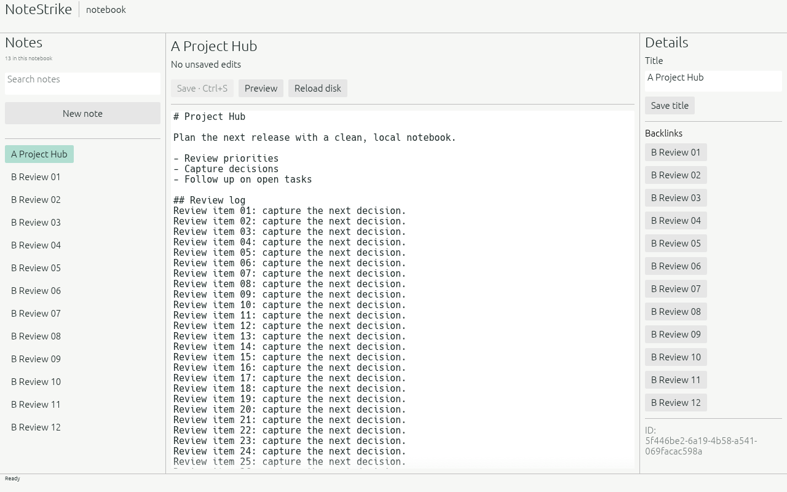
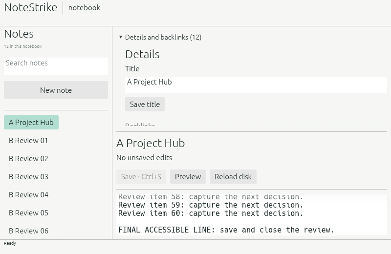

<p align="center">
  
</p>

<h1 align="center">NoteStrike</h1>

<p align="center">
  <a href="https://prowebdevsolutions.com"><picture>
    <source media="(prefers-color-scheme: dark)" srcset="assets/branding/PWDS-logo-orange.svg">
    
  </picture></a>
</p>

**Keep notes connected.**

NoteStrike keeps a Markdown notebook on your own machine. Create and edit notes, search titles and bodies, rename entries, and follow stable links between related ideas.

## Highlights

- Write and organize local Markdown notes.
- Search titles and note text.
- Follow backlinks across the notebook.

## Native editor preview





These genuine app-window captures show the current branch with a synthetic 60-line local note and 12 backlinks; the compact view shows its final line. [Current capture provenance](docs/current-editor-visual.md) records the exact source, hosted run, fixture, and hashes. The [earlier Field Log capture](assets/screenshots/note-editor.png) and its [provenance](docs/SCREENSHOT_PROVENANCE.md) document the previous workspace.

## Current status

Native editor alpha source. The notebook core and optional native editor passed hosted Windows tests and a native Linux software-rendering capture, including a conflict-recovery case. Native pointer and accessibility behavior, attachments, backup and restore, and installer packaging remain open.

## Keep links through a rename

Each note has a stable ID, so a title change does not erase its backlinks. Search covers titles and bodies. When an outside edit collides with a save, the current core leaves a staged recovery copy instead of silently replacing the changed note.

## Build and verification

NoteStrike is a local Rust Markdown notebook prototype. The command-line app creates notes, edits and renames them, searches local titles and bodies, and follows stable-ID backlinks. The optional native Windows editor provides note list/search, body edit/save, rename, backlinks, conflict-copy, and disk reload through the same notebook core.

From this standalone source root:

```powershell
cargo test --locked --features native-ui
cargo run --locked --bin notestrike -- init demo-notebook
cargo run --locked --features native-ui --bin notestrike-native -- demo-notebook
```

The lockfile was derived from the tested Office lock without adding package versions. A fresh checkout needs ordinary crates.io access for uncached dependencies. The accepted Windows checkpoint passed nine integration tests, and its compiled native action test passed 100 consecutive reruns. An independent reproduction confirmed that an external edit made during the Windows rename retry remains on disk, returns a conflict, and leaves the staged recovery copy available.

Current limits: native pointer, focus, screen-reader, and accessibility behavior were not accepted; attachments, a recovery-choice UI, FTS index, and backup/restore are incomplete. The final path-identity check and rename are not an atomic compare-and-swap against an adversarial path replacement. Other platforms and installers have not been verified. No installer is supported by this source checkpoint.

Tests generate disposable Markdown notebooks in the system temporary directory; no user notes are included. See [SOURCE_SCOPE.md](SOURCE_SCOPE.md) for dependency attribution and ownership. No first-party license grant is stated for NoteStrike here.

## PWDS brand artwork

The company mark in this masthead is the existing [official PWDS logo](https://github.com/Gerbzz/PWDS-Website/blob/main/public/prowebdevsolutions-logo.png), with the [official orange display asset](https://prowebdevsolutions.com/images/prowebdevsolutions-logo-orange.svg) for dark backgrounds. Any app logo above it remains the original Strike suite artwork.
