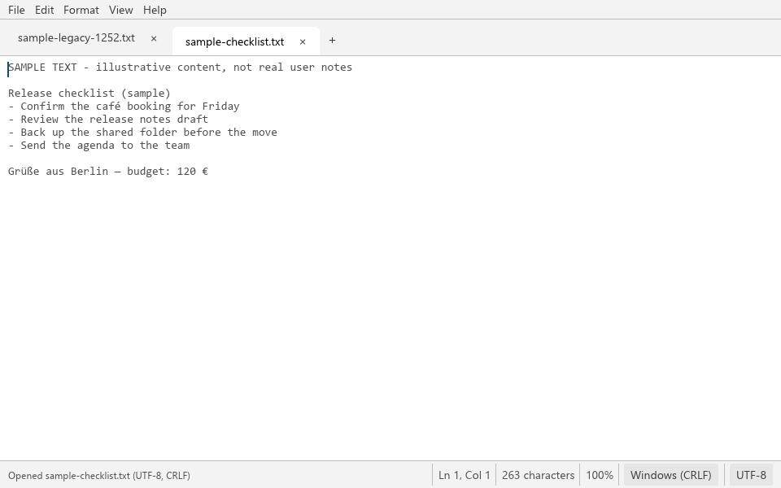
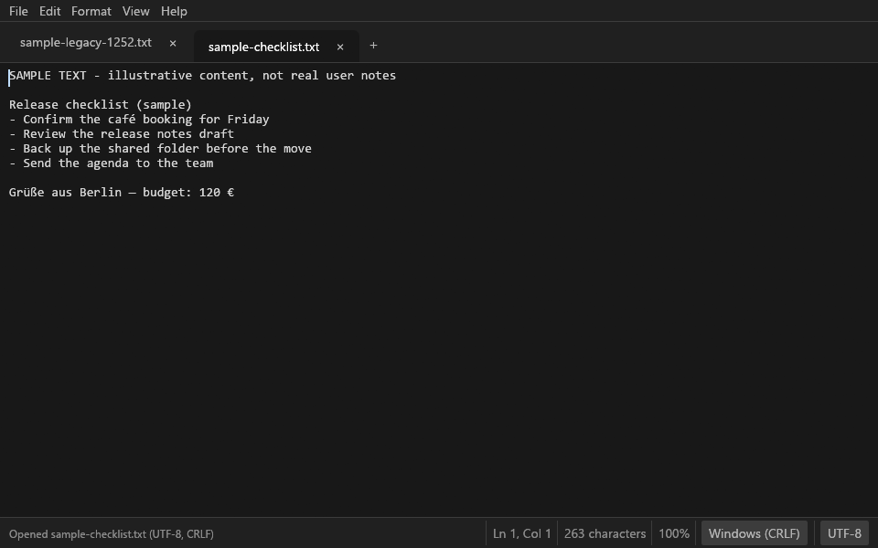
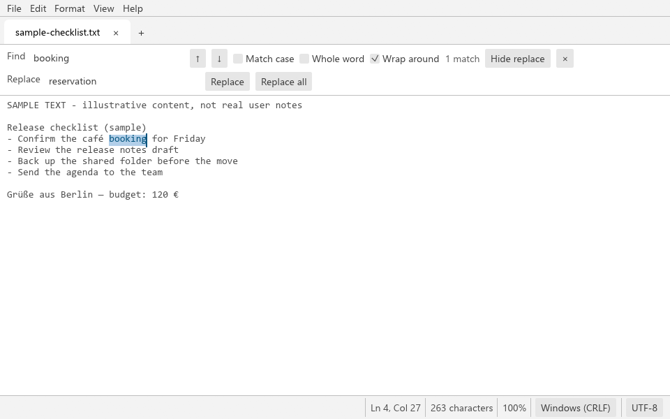
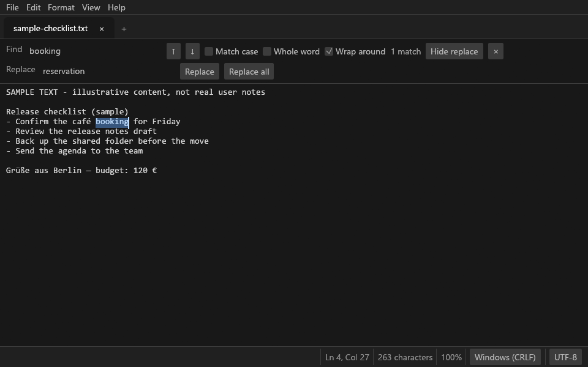
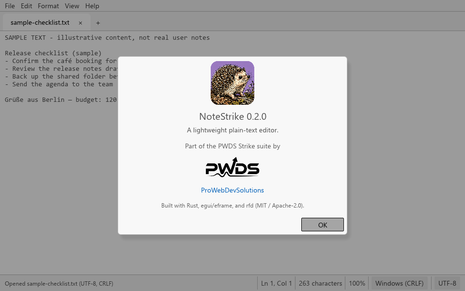
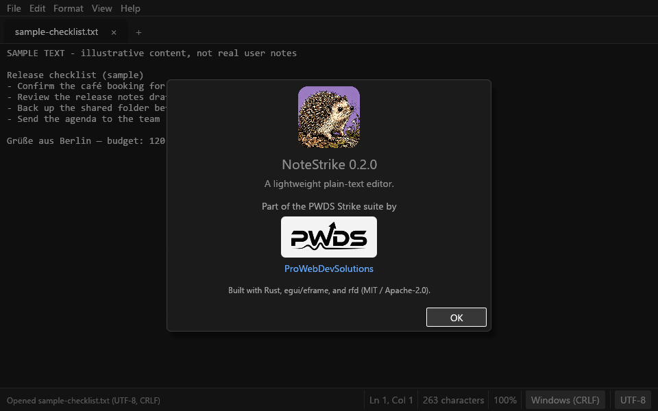
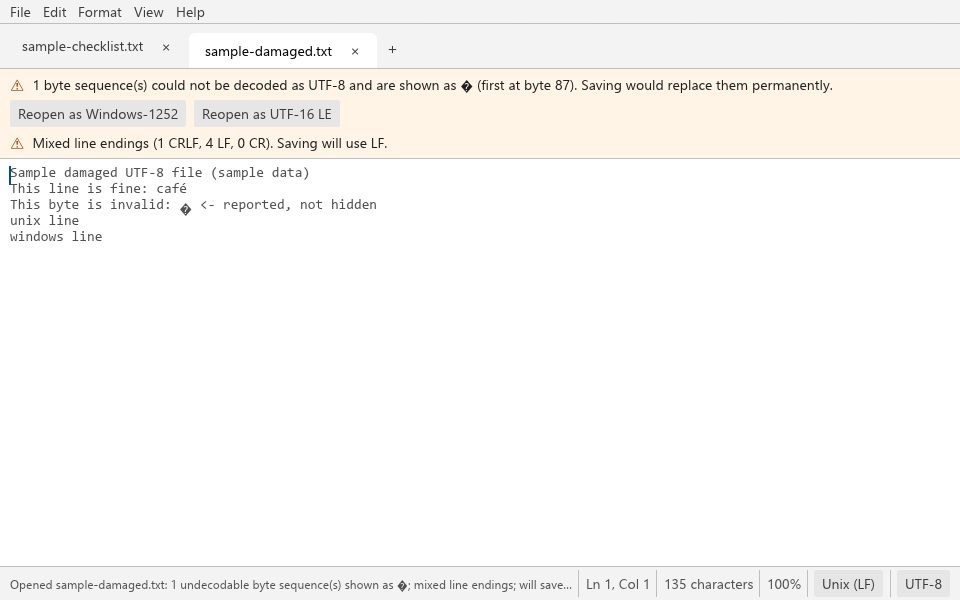
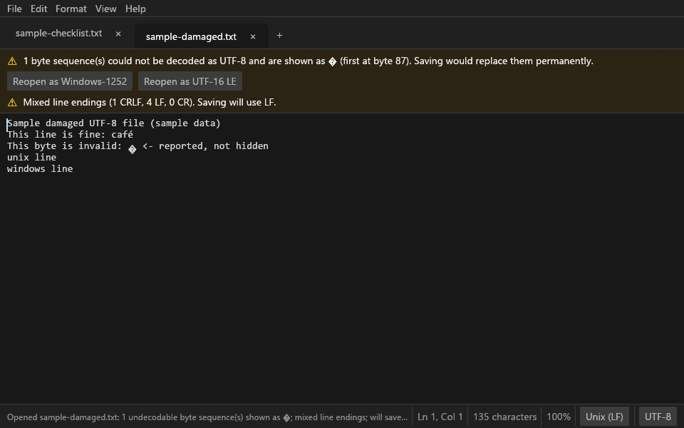
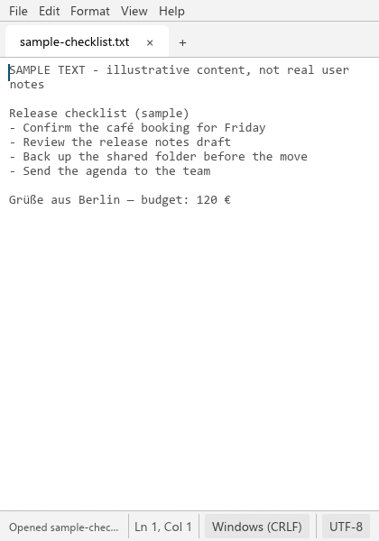
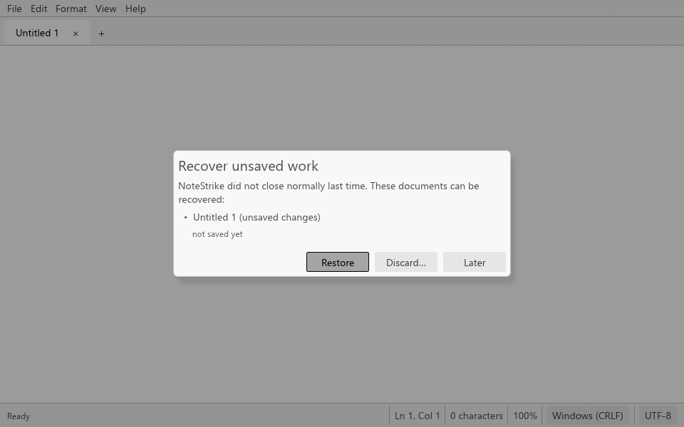

<p align="center">
  
</p>

<h1 align="center">NoteStrike</h1>

<p align="center"><strong>A lightweight plain-text editor for Windows, written in Rust.</strong><br>
Tabs, safe saves, encodings and line endings handled honestly, and your unsaved work recovered after a crash.</p>

<p align="center">
  Status: <strong>alpha</strong> · Platform tested: Windows 11 · Part of the PWDS Strike suite
</p>



*Real NoteStrike window in the **Light** theme, captured from the current build with sample text. Dark-theme captures are under [Screenshots](#screenshots).*

## Why NoteStrike

NoteStrike replaces Notepad for everyday text files: configs, logs, notes, READMEs. It stays small and familiar on purpose. It is **not** an IDE and **not** a notebook or wiki: no projects, no plugins, no Markdown rendering, no links between notes.

What it does care about is not losing or corrupting your text:

- **Familiar by design.** Menu bar, tabs, status bar, and the Notepad shortcuts you already know.
- **Safe saves.** Every save writes a temporary file, flushes it to disk, and then replaces the original in one step. If the save is interrupted, the original file is still intact.
- **Honest encodings.** UTF-8 (with or without BOM), UTF-16 LE/BE, and Windows-1252 are detected and written back the way they were found. Bytes that cannot be decoded are reported, never silently replaced.
- **Crash recovery.** Unsaved text is journaled in the background and offered back after a crash or forced shutdown.

## Features

Everything in this list is implemented and covered by automated tests (see [Verification](#verification)). The list of what has *not* yet been checked by hand on a real desktop is under [Implemented vs planned](#implemented-vs-planned).

### Editing
- Plain-text editing in tabs, with new, open, save, save as, save all, and close tab.
- Find and replace: match case, whole word, wrap around, find next/previous, replace, replace all, and a live match count.
- Go to line, undo/redo, cut/copy/paste, select all.
- Word wrap and text zoom (50–400%).
- **Themes:** View > Theme > System (follow Windows) / Light / Dark. The default is System. A change applies immediately and is remembered across restarts (in `settings.json`). If Windows does not report a preference, System uses the dark theme (egui's fallback). Both themes are checked against WCAG AA contrast in the tests: text, dialogs, notices, selection, links, and buttons.
- Open files from the command line (`notestrike a.txt b.log`) or by dragging them onto the window.

### Encodings and line endings
- Detects UTF-8, UTF-8 with BOM, UTF-16 LE/BE (with or without BOM, sniffed from NUL patterns), and falls back to Windows-1252 for legacy single-byte files.
- Damaged UTF-8 or UTF-16 is decoded as far as possible. A notice shows how many byte sequences could not be decoded and where the first one is, and offers to reopen the file in another encoding. Saving such a file asks first, because the U+FFFD replacement characters would become permanent.
- Saving in Windows-1252 refuses characters it cannot represent and offers UTF-8 instead. It never writes `?`.
- Detects CRLF, LF, and CR line endings and keeps them on save. Mixed line endings are reported, and the dominant one is used.
- The status bar shows, and lets you change, the encoding and line endings used for the next save.

### Not losing work
- **Atomic saves:** temp file in the same folder, `fsync`, then rename. A failed or interrupted save leaves the original untouched.
- **External changes:** open files are checked every 2 seconds. If another program changed or deleted a file, a notice offers Reload or Keep my version. Saving over an external change asks you to overwrite, save as a new file, or cancel.
- **Read-only files** are detected and offered Save As.
- **Unsaved-change prompts** on tab close, window close (including Alt+F4), and File > Exit: Save / Don't save / Cancel. Cancelling any Save As dialog stops the close.
- **Crash/session recovery:** each tab is journaled to `%LOCALAPPDATA%\PWDS\NoteStrike\recovery` about a second after you stop typing. After a crash, NoteStrike offers Restore / Discard / Later for unsaved text and reopens the files that were open. A normal exit deletes the journal.
- **Large files:** files over 8 MiB need confirmation; files over 64 MiB are refused (NoteStrike keeps the whole text in memory).

### Accessibility
- AccessKit is enabled. The editor, tabs ("Tab 2 of 3: notes.txt, modified"), and icon-only buttons have accessible names, and the find and replace fields are labelled.
- Every command has a keyboard shortcut. The first button of each dialog is focused, and Esc cancels.

## Screenshots

Every image is a real frame of the current build in the theme named under it. All text is sample content.

| Light theme | Dark theme |
|---|---|
| <br>**Editor, Light** | <br>**Editor, Dark** |
| <br>**Find and replace, Light** | <br>**Find and replace, Dark** |
| <br>**About, Light** | <br>**About, Dark** |
| <br>**Damaged UTF-8 notices, Light** | <br>**Damaged UTF-8 notices, Dark** |
| <br>**Narrow window (420 px), Light** | <br>**Recovery after a real crash, Light** |

The app's own `--capture` mode rendered and saved each frame at the window's size. For the find/replace and About shots it was run with `--find` or `--about`, which open that bar or dialog before the frame is taken. These are not mockups. [docs/screenshots.md](docs/screenshots.md) records the commands and hashes.

## Keyboard shortcuts

| Action | Keys |
|---|---|
| New tab / Open / Save / Save as | Ctrl+N (or Ctrl+T) / Ctrl+O / Ctrl+S / Ctrl+Shift+S |
| Close tab / Next / previous tab | Ctrl+W / Ctrl+Tab / Ctrl+Shift+Tab |
| Undo / Redo | Ctrl+Z / Ctrl+Y |
| Find / Find next / Find previous / Replace | Ctrl+F / F3 / Shift+F3 / Ctrl+H |
| Go to line | Ctrl+G |
| Zoom in / out / reset | Ctrl+Plus / Ctrl+Minus / Ctrl+0 |
| Close the find bar or a dialog | Esc |

## Coming from NoteStrike 0.1 (Markdown notebook)

NoteStrike 0.1 was a Markdown notebook prototype. It kept notes in a folder you chose (`notestrike init DIR`) as `DIR/notes/*.md` files with a small front-matter header. It never used a fixed AppData or Documents location.

**NoteStrike 0.2 never deletes, moves, or rewrites those notes.** You have two ways to keep using them:

- **Import as plain files:** File > *Import NoteStrike 0.1 notebook…*, or `notestrike-cli import-notebook NOTEBOOK_DIR DEST_DIR`. Each note's body is copied to `DEST_DIR/<title>.md` without the front matter, and the copy keeps the note's modified time. Notes that cannot be parsed are copied byte for byte. Existing files in the destination are never overwritten (`Title (2).md` is used instead), and a destination inside the notebook's `notes` folder is refused. The notebook is only read.
- **Open directly:** a 0.1 note is a plain `.md` file, so File > Open works on it. Opening does not change it; only saving your own edits does.

`notestrike-cli list-notebook NOTEBOOK_DIR` lists a notebook without touching it. Backup files the 0.1 repair command left behind (`*.md.<id>.bak`) and the empty `assets` folder are not imported, but they are left in place.

## Build and run

Requires a recent stable Rust toolchain (tested with 1.96.1).

```powershell
cargo build --release --locked
.\target\release\notestrike.exe                # the editor
.\target\release\notestrike.exe notes.txt      # open files
.\target\release\notestrike-cli.exe inspect notes.txt
```

`cargo build --no-default-features` builds only the library and `notestrike-cli`, with no GUI dependencies. Set `NOTESTRIKE_DATA_DIR` to keep settings and the recovery journal somewhere else (for example, for a portable copy).

## Verification

```powershell
cargo fmt --check
cargo clippy --locked --all-targets -- -D warnings
cargo test --locked
```

The tests (56 passing, plus one helper that a test runs as a child process) create their own files in the system temp folder and never touch user documents. They cover:

- Round trips of every encoding and line ending, byte for byte.
- Damaged UTF-8 and UTF-16, binary files, and Windows-1252 fallback.
- Interrupted saves (temp file cleaned up, or left behind as a killed process would leave it), read-only files, external changes and deleted files, touch-without-change, repeated saves, size limits.
- Cancelling every dialog and prompt; save/close/quit flows; reopening.
- Recovery after a simulated crash and after a real `abort()` of a child process.
- The 0.1 notebook import, with byte and timestamp checks proving the notebook is unchanged.
- Headless frames of the real UI: typing, Ctrl+S, the window close request, every prompt, and find selection.
- Themes: System follows the OS and explicit choices override it, a change applies on the next frame, the choice persists across a restart, and every colour pair passes WCAG AA in both themes.

## Limitations

- **Tested on Windows 11 only.** The code builds for Linux and macOS through eframe, but those platforms have not been run.
- **Not a large-file editor.** The whole file stays in memory and is laid out by egui; a few MB is comfortable, and files over 64 MiB are refused.
- **Mixed line endings** are unified to the dominant style on save (you are told when the file opens).
- **Saving replaces the file** through a rename. This keeps the content safe, but a hard link to the old file keeps the old content, and Windows ACLs or alternate data streams on the original file are not copied.
- **Polling** for external changes compares size and modified time; a same-size edit within the file system's timestamp resolution is only caught at save time, when the file is re-hashed.
- **No printing**, no right-to-left or complex-script shaping beyond what egui provides, no spell check, no session restore after a *normal* exit (only after a crash).
- **No IME composition testing** has been done.
- **No installer** and no file associations yet.

## Implemented vs planned

| Area | Status |
|---|---|
| Tabs, open/save/save as/save all, find/replace, go to line, zoom, wrap, themes | Implemented |
| Encoding detection and handling, line-ending preservation | Implemented |
| Atomic saves, external-change and read-only handling, unsaved-change prompts | Implemented |
| Crash recovery journal | Implemented |
| 0.1 notebook import | Implemented |
| Interactive desktop walkthrough with mouse and keyboard (OS dialogs, clipboard menu items, screen reader) | **Not yet verified.** See [docs/screenshots.md](docs/screenshots.md) |
| Installer, file associations, "Open with" | Planned |
| Session restore after normal exit, recent files | Planned |
| Printing | Planned |
| Linux and macOS verification | Planned |

## Credits and licenses

- Built with [egui / eframe](https://github.com/emilk/egui) (MIT OR Apache-2.0), [rfd](https://github.com/PolyMeilex/rfd) (MIT) for native file dialogs, [image](https://github.com/image-rs/image) (MIT OR Apache-2.0), [sha2](https://github.com/RustCrypto/hashes) (MIT OR Apache-2.0), [uuid](https://github.com/uuid-rs/uuid) (MIT OR Apache-2.0), [serde_json](https://github.com/serde-rs/json) (MIT OR Apache-2.0), and [same-file](https://github.com/BurntSushi/same-file) (MIT OR Unlicense). The full dependency graph is in `Cargo.lock`.
- On Windows, NoteStrike uses the Segoe UI and Consolas fonts already installed with the system; it does not bundle them. egui's built-in fonts are the fallback.
- The README layout takes inspiration from [PhotoCraft](https://github.com/storytold/photocraft) and [ArtCraft](https://getartcraft.com/): a short pitch, highlights, real screenshots with captions, and a frank status section. No code, text, or assets were copied from either project.
- The NoteStrike hedgehog logo is original Strike suite artwork ([provenance](assets/branding/provenance.json)). The [PWDS logo](assets/branding/PWDS-logo.png) appears only in Help > About.

NoteStrike is a [ProWebDevSolutions](https://prowebdevsolutions.com) project. This checkout makes no first-party license grant. See [SOURCE_SCOPE.md](SOURCE_SCOPE.md).
