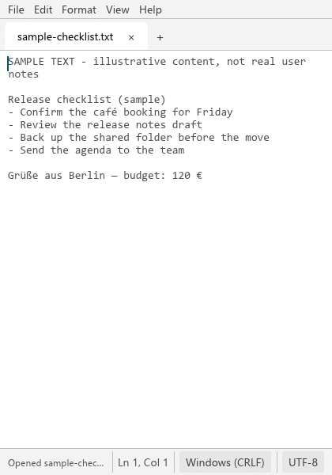
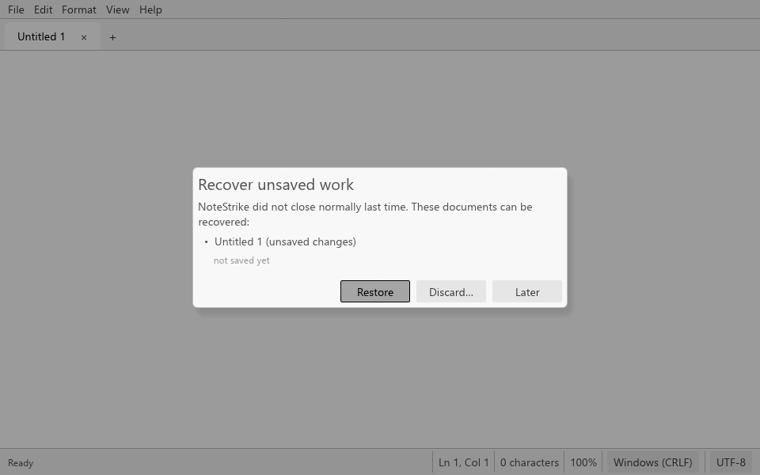

# Screenshot notes

## Current native editor capture — 21 October 2026

The [current README image](../assets/screenshots/notestrike-editor-native-2026-10-21.png) is the unchanged 960 × 640 PNG produced by NoteStrike's native eframe editor in hosted Linux CI. It shows `fixture.txt` in the dark theme, with sample project notes, the menu bar, one tab and the status bar. The file contains 73 characters in UTF-8 with LF line endings.

- Source PR head: [`96cc5b2ec77deabb4fb0dda031adcd711df57e61`](https://github.com/Gerbzz/NoteStrike/commit/96cc5b2ec77deabb4fb0dda031adcd711df57e61).
- Actual hosted checkout: test merge [`4f0e16b628dd63928c02795d552968ac91339425`](https://github.com/Gerbzz/NoteStrike/commit/4f0e16b628dd63928c02795d552968ac91339425).
- Tested tree: `c3d0977e0f258d862a982ee3f17cfe10a6821677`, identical to main merge [`7ec3e4818c8d57b8c6c6e3fb5f91dc07e60d4f0f`](https://github.com/Gerbzz/NoteStrike/commit/7ec3e4818c8d57b8c6c6e3fb5f91dc07e60d4f0f).
- Hosted run: [39579103581](https://github.com/Gerbzz/NoteStrike/actions/runs/39579103581), [Linux job 119151963900](https://github.com/Gerbzz/NoteStrike/actions/runs/39579103581/job/119151963900). Tests, editor build and populated capture passed. The same run's Windows job also passed its tests and native build.
- Artifact: `notestrike-editor-visual`, ID `12335108547`; original member `editor.png`, 35,838 bytes.
- Raw PNG SHA-256: `783bca5260e8d85b40a3a94d2aa29d7a3ba919b901f02166b0adec3644e49caa`.
- Uploaded artifact ZIP SHA-256 recorded by Actions: `a81171d68f83cde2caf079211093f8402e25d75e9696252bc725297c048faf28`.

The workflow built `notestrike` with `--locked --features native-ui`, rendered it under Xvfb using software OpenGL, and invoked its own capture mode:

```text
notestrike --capture editor.png 960 640 fixture.txt
```

The fixture text is synthetic:

```text
Project Hub

Review priorities
Capture decisions
Follow up on open tasks
```

The image verifies the native editor's populated content area. It does not include an OS title bar, taskbar, application mark or About panel, so it does not establish their appearance. It is hosted rendering evidence, not an interactive Room acceptance session or a release/installer claim. No new native build or capture was needed to publish these existing bytes.

## Historical Windows captures

The four earlier captures below are real frames of the NoteStrike build at historical commit `ab6deae`. They are retained for reference and are not current UI evidence. Each was produced on Windows 11 by the app's own `--capture OUT.png WIDTH HEIGHT [FILES]` mode. That mode opens the real window, waits a few painted frames, asks eframe for a screenshot of the window, writes it as a PNG, and exits cleanly. The images are cropped to the app window by construction. No mockups or edits were made.

All visible text is sample content written for these captures. The files lived in `%TEMP%\NoteStrike-samples\docs`, and each run used its own `NOTESTRIKE_DATA_DIR`.

| File | Command (abridged) | SHA-256 |
|---|---|---|
| `notestrike-editor-light.png` | `notestrike --capture … 960 600 sample-legacy-1252.txt sample-checklist.txt` | `c52294e0e4ddf07aca0a3704a691e7b23a3e9152c39edbc223a7f9e4ab396314` |
| `notestrike-damaged-utf8-dark.png` | settings `{"theme":"dark","zoom_percent":110}`; `notestrike --capture … 960 600 sample-checklist.txt sample-damaged.txt` (contains a stray 0xFF byte and mixed CRLF/LF) | `958568c0cfde7f4b559adacb954bee25dcfd116af358787e39e40c62a1dda64e` |
| `notestrike-compact.png` | `notestrike --capture … 420 600 sample-checklist.txt` | `b58c211afbd763baf7b22c65da92cd21bdf160c65a1d029d421a49e65a8c53a9` |
| `notestrike-crash-recovery.png` | The `crash_child` test helper (`tests/recovery.rs`) typed text into a workspace, journaled it, and called `std::process::abort()`. Then `notestrike --capture … 960 600` was started against that data folder. | `6b35048a4ea1755612398db859c270a661b05d04d1b4ff494e009920f04e5c30` |

### Historical gallery

| Light editor | Damaged UTF-8, dark theme |
|---|---|
|  |  |

| Narrow window | Recovery dialog |
|---|---|
|  |  |

### Historical interactive verification limits

The plan was to also drive the running build with mouse and keyboard through desktop automation (computer use): typing, menus, the Windows file dialogs, cut/copy/paste from the Edit menu, and closing with unsaved changes. When that access was requested for the NoteStrike window, it was **denied**, so no interactive desktop session took place.

These behaviours are covered only by headless tests that run the real UI code on synthetic input, not by a person or an automated session using the real window:

- typing and Ctrl+S
- the window close request with unsaved text
- rendering of every prompt
- the narrow-layout find bar

These behaviours are still unverified on a real desktop:

- the native Open, Save As, and folder pickers (rfd)
- the Edit menu Cut/Copy/Paste items, which use egui viewport clipboard commands
- drag-and-drop of files onto the window
- screen-reader output through AccessKit

